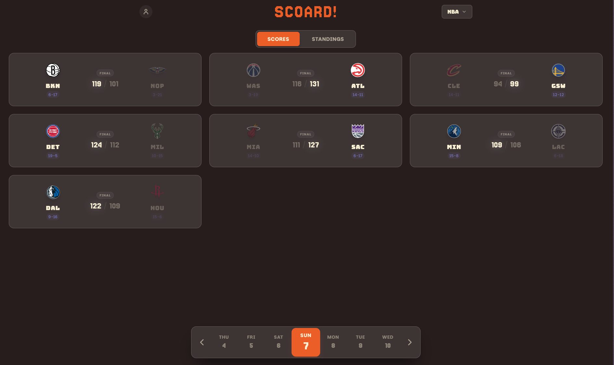

# SCOARD: See the game blind

A modern NBA score app with data visualization to simulate the feeling of watching the game without watching it

**Live:** [scoard.onrender.com]([https://scoard.onrender.com])




<!-- TABLE OF CONTENTS -->
<details>
  <summary>Table of Contents</summary>
  <ol>
    <li><a href="#features">Features</a></li>
    <li><a href="#tech-stack">Tech Stack</a></li>
    <li>
      <a href="#getting-started">Getting Started</a>
      <ul>
        <li><a href="#prerequisites">Prerequisites</a></li>
        <li><a href="#installation">Installation</a></li>
        <li><a href="#running-the-application">Running the Application</a></li>
      </ul>
    </li>
    <li>
      <a href="#api-routes">API Routes</a>
      <ul>
        <li><a href="#live-updates-sse">Live updates (SSE)</a></li>
      </ul>
    </li>
    <li><a href="#project-structure">Project Structure</a></li>
    <li><a href="#contributing">Contributing</a></li>
  </ol>
</details>

## Features

-   **Live Scoreboard:** Real-time updates for all NBA games with live scores, game clock, and quarter information (SSE-powered for live games).
-   **Enhanced Virtual Court Visualization:** 
    -   **Sequential Playback:** Intelligent event queue system that visualizes plays one-by-one for a broadcast-like experience.
    -   **Dynamic Overlays:** Visual alerts for timeouts, substitutions, and quarter transitions.
    -   **Smart Notifications:** Context-aware side popups displaying points, rebounds, assists, steals, and blocks.
    -   **Accurate Shot Mapping:** Precise shot location visualization with specific logic for offensive/defensive rebounds and free throws.
-   **Game Schedule:** Browse past results and upcoming fixtures with an intuitive date picker interface.
-   **Comprehensive Stats:** Access detailed box scores, play-by-play feeds, and team performance metrics with active player indicators.
-   **League Standings:** Full NBA standings with conference/division rankings, win-loss records, and current streaks.
-   **Modern UI:** Featuring a "Fun Pastel" dark theme with glassmorphism effects, smooth Framer Motion animations, and fully responsive design.

## Tech Stack

-   **Framework:** Next.js 15
-   **UI Library:** React 19
-   **Styling:** Tailwind CSS
-   **Animations:** Framer Motion
-   **Icons:** Lucide React
-   **HTTP Client:** Axios
-   **Date Handling:** date-fns
-   **Language:** TypeScript 5
-   **Data Sources:** NBA Official CDN & Stats APIs

## Getting Started

### Prerequisites
-   Node.js (v18+ recommended, tested on v22.19.0)
-   [pnpm](https://pnpm.io/) (v10+ recommended)
    ```bash
    npm install -g pnpm
    ```

### Installation

1.  **Clone the repository**
    ```bash
    git clone https://github.com/KushalM23/Scoard.git
    cd Scoard
    ```

2.  **Install Dependencies**
    ```bash
    pnpm install
    ```

### Running the Application

**Development:**
```bash
pnpm dev
# Runs on http://localhost:3000
```

**Production:**
```bash
pnpm build
pnpm start
```

**Package Manager:**
- This project uses [pnpm](https://pnpm.io/) for package management
- Tested with Node.js v22.19.0 and pnpm v10+
- A `pnpm-lock.yaml` file is included for reproducible installs

## API Routes

The app includes serverless API routes:

- `GET /api/games/date/[date]` - Fetch all games for a specific date (format: YYYY-MM-DD)
- `GET /api/games/[gameId]` - Get detailed game data including scores, players, and stats
- `GET /api/games/[gameId]/pbp` - Get play-by-play data for live game visualization
- `GET /api/games/[gameId]/stream` - Server-Sent Events (SSE) stream for live game state; clients connect via `EventSource`
- `GET /api/standings` - Fetch current NBA league standings

All routes use NBA's official CDN and Stats APIs with no authentication required.

### Live game updates
- The game page polls `/api/games/[gameId]` and `/api/games/[gameId]/pbp` with adaptive delays and stops after the game is final.
- The play-by-play route prefers the CDN and falls back to Stats API play-by-play v3/v2 when an archived or incomplete payload is returned. V3 shot-chart coordinates are converted for field-goal events; events without usable coordinates remain timeline-only.
- The `/api/games/[gameId]/stream` SSE route remains available, but its per-game pollers and clients are held in process memory. That state is not shared between serverless instances, so deployments that scale across instances must not rely on it for consistent updates.
- The court animates newly received events and can replay the same normalized event list used by the timeline. Coordinates mark recorded events only; they do not describe continuous player movement.
- Before public release, confirm permission to display live and archived NBA play-by-play. Access to a public feed does not by itself grant display or redistribution rights.

## Project Structure

```
Scoard/
├── app/                          # Next.js App Router
│   ├── api/                      # API routes (serverless functions)
│   │   ├── games/
│   │   │   ├── [gameId]/        # Individual game data
│   │   │   │   ├── route.ts     # Game details endpoint
│   │   │   │   └── pbp/         # Play-by-play data
│   │   │   │       └── route.ts
│   │   │   └── date/[date]/     # Games by date
│   │   │       └── route.ts
│   │   └── standings/           # NBA standings API
│   │       └── route.ts
│   ├── components/              # React components
│   │   ├── GameCard.tsx         # Game list item with score display
│   │   ├── Header.tsx           # Navigation header
│   │   ├── Hero.tsx             # Hero section with date picker
│   │   ├── Layout.tsx           # Page layout wrapper
│   │   ├── PreviousMatchups.tsx # Team head-to-head history
│   │   ├── Scoreboard.tsx       # Live game scoreboard with clock
│   │   ├── Standings.tsx        # League standings table
│   │   ├── StatsSection.tsx     # Box score statistics
│   │   ├── TopPerformers.tsx    # Top players display
│   │   ├── VirtualCourt.tsx     # Animated court visualization
│   │   └── WinProbability.tsx   # Win probability chart
│   ├── game/[gameId]/           # Dynamic game detail pages
│   │   └── page.tsx
│   ├── lib/                     # Shared utilities
│   │   └── statsApi.ts          # NBA Stats API client with retry logic
│   ├── types/                   # TypeScript type definitions
│   │   └── index.ts             # Game, team, player types
│   ├── layout.tsx               # Root layout with metadata
│   ├── page.tsx                 # Homepage with game listing
│   └── globals.css              # Global styles & custom theme variables
├── public/                      # Static assets (images, icons, fonts)
├── .gitignore                   # Git ignore rules
├── next.config.js               # Next.js configuration
├── next-env.d.ts                # Next.js TypeScript declarations
├── tailwind.config.ts           # Tailwind CSS config with custom theme
├── postcss.config.mjs           # PostCSS config for Tailwind
├── tsconfig.json                # TypeScript compiler config
├── package.json                 # Dependencies & scripts
├── pnpm-lock.yaml               # pnpm lock file
├── IMMEDIATE_OPTIMIZATION_STEPS.md  # Performance optimization guide
├── SSE_IMPLEMENTATION_PLAN.md   # Server-Sent Events implementation plan
├── NBA_API_GUIDE.md             # NBA API documentation
└── readme.md                    # This file
```

## Contributing

Contributions are welcome! Here's how you can help:

1. Fork the repository
2. Create a feature branch (`git checkout -b feature/amazing-feature`)
3. Commit your changes (`git commit -m 'Add amazing feature'`)
4. Push to the branch (`git push origin feature/amazing-feature`)
5. Open a Pull Request

Please ensure your code:
- Follows the existing TypeScript/React patterns
- Includes proper types for new components/functions
- Works on both desktop and mobile viewports
- Maintains the existing theme and design system
